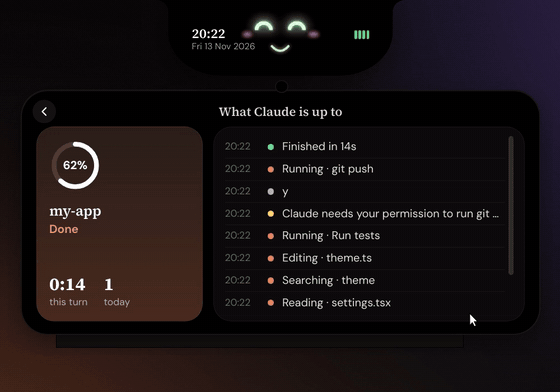
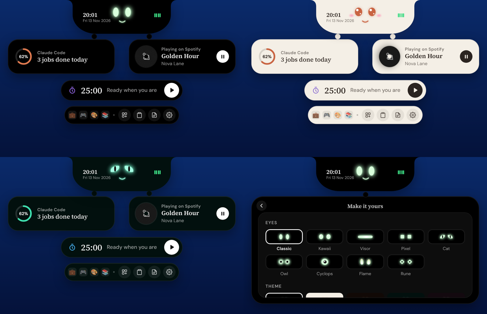

# Notch Buddy

**A tiny creature that lives in your Windows notch.** It watches Claude Code work, plays your music, runs a focus timer, opens your apps in one click, and lets you ask Claude anything without leaving what you're doing.

<p align="center">
  
</p>

> Independent project. Not affiliated with or endorsed by Anthropic. Claude and Claude Code are trademarks of Anthropic, PBC.

---

## What it does

When it's closed, the island is a small black notch with two glowing eyes at the top of your screen. Rest your cursor on it and it opens into a creature that talks to you in speech bubbles.

| | |
|---|---|
| **Claude Code status** | Live view of what Claude Code is doing (reading, editing, running tests), a timer, how much of the context window is used, and jobs done today. It glows and pops open when Claude needs your permission. |
| **Ask Claude** | Press **Ctrl+Alt+A** and type a question. Answers appear word by word, it remembers the conversation, and one click includes whatever is on your clipboard. Uses your own Claude Code login, so there's no API key. |
| **Music** | Whatever is playing in Spotify, your browser or any Windows media app, on a spinning record with play/pause and skip. |
| **Focus timer** | A pomodoro timer (15/25/50 minutes) with breaks. The notch keeps counting down while it's closed. |
| **Launchers** | Buttons with your own icon or emoji that open a set of apps, folders and websites at once. |
| **Clipboard and notes** | Your last 30 copied items, plus a scratchpad that saves automatically. |
| **Make it yours** | 9 eye styles (classic, kawaii, visor, pixel, cat, owl, cyclops, flame, rune), 10 themes and 3 fonts. |

The creature has moods: it smiles when idle, reads while Claude works, grins when a job finishes, looks worried when you're needed, and falls asleep after 10 quiet minutes.

<p align="center"></p>

It stays out of your way. Clicks pass through the closed notch to whatever is underneath (like browser tabs), it only opens when you rest the cursor on it, and you can move it to the left or right.

## Install

1. Download `Notch-Buddy-Setup-x.y.z.exe` from [**Releases**](../../releases).
2. Run it. Windows may say "Windows protected your PC" because the installer isn't code-signed. Click **More info → Run anyway**.
3. The island appears at the top of your screen, and there's an icon in the system tray.

On first launch it connects to Claude Code automatically (see below). Restart any Claude Code sessions that are already open.

**Shortcuts:** `Ctrl+Alt+Space` opens or closes the island. `Ctrl+Alt+A` opens Ask Claude.

## How the Claude Code connection works

The app adds a few [hooks](https://docs.claude.com/en/docs/claude-code/hooks) to `%USERPROFILE%\.claude\settings.json`, after backing it up to `settings.json.bak-island`. Each hook sends Claude Code's event (prompt submitted, tool used, needs permission, finished) to `http://127.0.0.1:47321` on your own machine. Nothing leaves your computer.

The context ring reads token usage from the session transcript and assumes a 200k-token window. You can change `contextWindow` in `%APPDATA%\Notch Buddy\island.json`.

To remove the hooks, run `npm run uninstall-hooks` from the source folder, or delete the entries that mention `127.0.0.1:47321` from your settings file.

## How Ask Claude works

Ask Claude runs the Claude Code CLI installed on your PC in print mode (`claude -p`) and streams its answer. That means:

- It uses whichever account Claude Code is signed into (check with `/status` in Claude Code). Questions count toward that plan's usage. If an `ANTHROPIC_API_KEY` environment variable is set, Claude Code uses that key instead and you're billed per use.
- Claude can't edit files or run commands from the island. It only answers.
- Conversations don't appear in claude.ai. Claude Code saves them locally under `%USERPROFILE%\.claude\projects\`.
- These questions aren't counted as Claude Code jobs on the island.

You need [Claude Code](https://docs.claude.com/en/docs/claude-code) installed and signed in once from a terminal.

## Build from source

You need Node.js 18 or newer.

```powershell
git clone https://github.com/<you>/notch-buddy.git
cd notch-buddy
npm install
npm start            # run it
npm run dist         # build the Windows installer into dist/
```

Building the installer on Linux or macOS needs Wine.

## Project layout

```
main.js                  window, tray, hook server, media bridge, clipboard, launchers
ask.js                   Ask Claude bridge (runs `claude -p`)
preload.js               safe bridge between the UI and the main process
renderer/                the island UI (HTML/CSS/JS, fonts)
scripts/media.ps1        reads Windows media sessions via PowerShell/WinRT
scripts/install-hooks.js adds/removes the Claude Code hooks
```

## Troubleshooting

- **The island doesn't react to Claude Code.** Restart your Claude Code sessions, since hooks load when a session starts. Then check the log (tray icon → **Open debug log**) for `hook` lines.
- **Music says nothing is playing.** The player has to show up in Windows' media flyout (the one you get from the volume keys).
- **Ask Claude shows an error.** Make sure `claude` works in a terminal and that you're signed in.
- **Anything else.** The tray icon has **Open debug log**. Please include it when you open an issue.

## Credits

Fonts: [Source Serif 4](https://github.com/adobe-fonts/source-serif) and [DM Sans](https://github.com/googlefonts/dm-fonts), both under the SIL Open Font License (see `renderer/fonts/`).

## License

[MIT](LICENSE)
